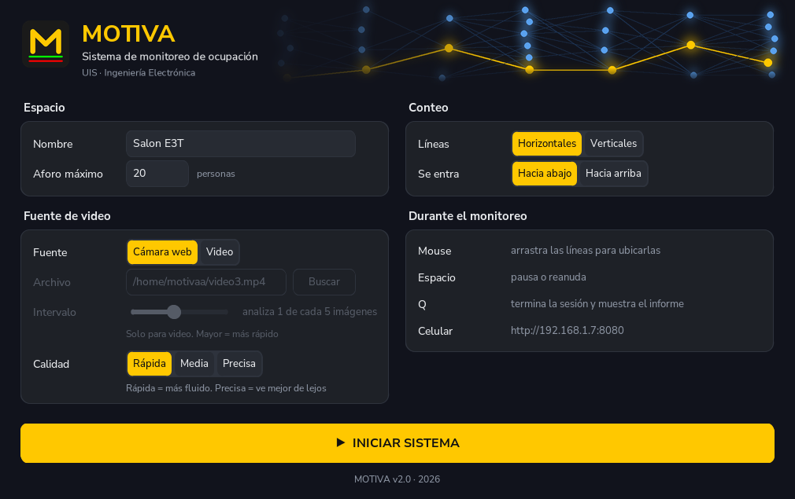
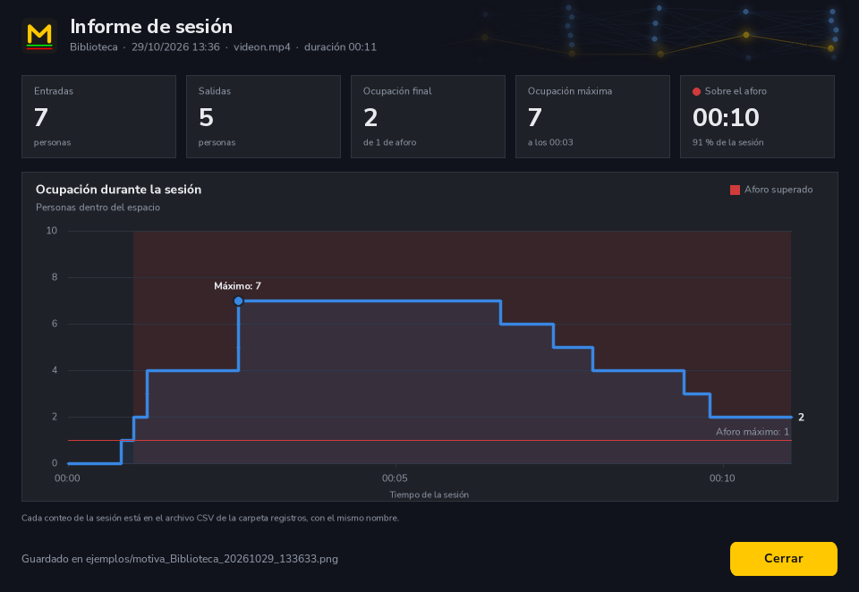
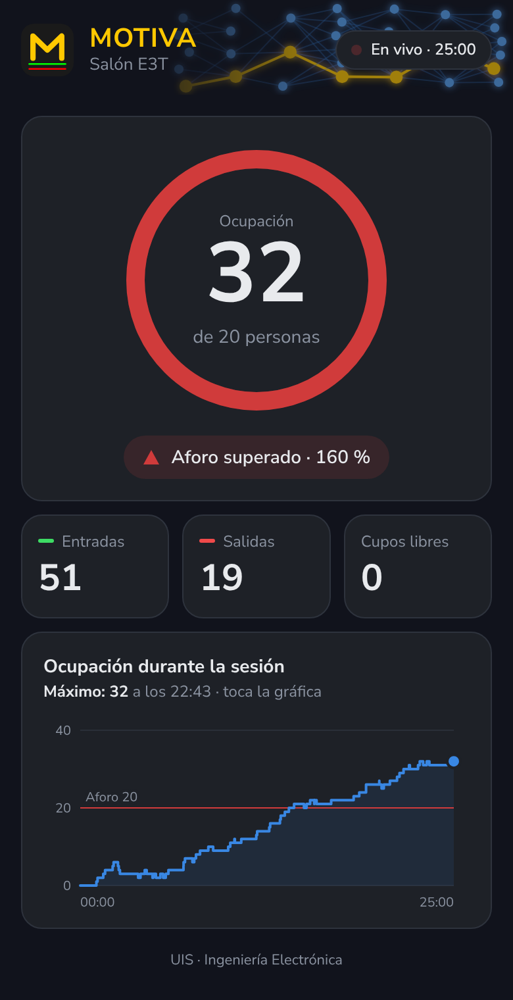

# MOTIVA

Sistema de conteo de personas y monitoreo de aforo que corre en una Raspberry Pi 4 con una cámara web. Detecta a las personas con un modelo YOLO11s entrenado para el proyecto, las sigue con ByteTrack y cuenta una entrada o una salida cuando cruzan dos líneas en la imagen. Con eso calcula la ocupación del espacio y avisa cuando se supera el aforo: en pantalla, con un LED y en una página web que se abre desde el celular.

Trabajo de grado de Ingeniería Electrónica, Universidad Industrial de Santander (UIS).



## Qué hace

- **Cuenta entradas y salidas** con una cámara web o con un archivo de video, usando dos líneas (verde y roja) que se ubican con el mouse, horizontales o verticales, en el sentido que se elija.
- **Calcula la ocupación** y la compara con el aforo máximo del espacio.
- **Avisa cuando se supera el aforo:** franja roja en la ventana de video, LED que parpadea (GPIO17) y estado en la página del celular.
- **Página para el celular:** en la misma red wifi, `http://<ip-de-la-raspberry>:8080` muestra la ocupación, las entradas, las salidas y la gráfica de la sesión, actualizadas cada segundo.
- **Informe al terminar:** cinco cifras y la gráfica de ocupación en el tiempo, guardado como imagen junto al registro CSV de cada conteo.
- **Recuerda la configuración** y la posición de las líneas entre sesiones.

| Informe de sesión | Página del celular |
|---|---|
|  |  |

## Cómo funciona, en breve

1. Un hilo lee la cámara (o el video) y otro ejecuta el modelo, para que la imagen no se congele mientras detecta.
2. El modelo (YOLO11s de una clase, formato OpenVINO) entrega las cajas de las personas, y ByteTrack les asigna un identificador que se mantiene de una imagen a otra.
3. Según el centro de cada caja y su posición anterior respecto a las líneas, se suma una entrada o una salida.
4. En cámara, un filtro descarta los objetos que nunca se mueven (por ejemplo, ropa amontonada que el modelo confunde con una persona).

El detalle completo está en [`docs/`](docs/): funcionamiento, interfaz, mediciones, limitaciones y entorno.

## Equipo

- Raspberry Pi 4 Model B de 4 GB, con Raspberry Pi OS de 64 bits (Debian 13).
- Cámara web USB, usada a 640x480.
- Opcional: un LED con una resistencia de 220 a 330 Ω entre el pin físico 11 (GPIO17) y el pin físico 9 (tierra).
- La cámara está pensada para ir en alto, mirando hacia la entrada: el modelo se entrenó con vistas desde arriba.

## Instalación

```bash
git clone <este repositorio> motiva
cd motiva
python3 -m venv motiva_env
source motiva_env/bin/activate
pip install -r requirements.txt
```

## Uso

```bash
source motiva_env/bin/activate
python3 motiva_app.py
```

El programa abre ventanas, así que necesita el escritorio de la Raspberry. Para abrirlo con doble clic, copia `acceso_directo/MOTIVA.desktop` al escritorio y cambia en él las rutas `/home/motivaa` por la carpeta donde descargaste el repositorio.

En el menú se escribe el nombre del espacio y el aforo, se elige la fuente y las opciones de conteo, y se pulsa INICIAR SISTEMA. Durante el monitoreo: el mouse mueve las líneas, ESPACIO pausa y Q termina la sesión.

Cada sesión con conteos deja en `registros/` un CSV (`Tiempo, Entradas, Salidas, Ocupacion`) y la imagen de su informe.

## Estructura

| Ruta | Qué es |
|---|---|
| `motiva_app.py` | El programa completo |
| `modelos/best_junio_openvino_model/` | El modelo entrenado, en formato OpenVINO |
| `modelos/tracker_motiva.yaml` | Configuración de ByteTrack, ajustada para pocas detecciones por segundo |
| `motiva_icono.png` | Ícono de la aplicación |
| `acceso_directo/MOTIVA.desktop` | Acceso directo para el escritorio |
| `docs/` | Documentación técnica y capturas |

## Rendimiento medido

En la Raspberry Pi 4, sin acelerador:

- Unas 2 a 3 detecciones por segundo con la cámara en calidad Rápida, con el video mostrado a unos 25 fps.
- OpenVINO es entre 20 y 45 % más rápido que ONNX Runtime con el mismo modelo y los mismos resultados.
- Con la gente grande en la imagen, el conteo en vivo es comparable al del análisis de video; con mucha gente pequeña y lejana, en vivo cuenta alrededor de la mitad.

Los conteos se compararon entre configuraciones del propio sistema, no contra un conteo hecho a mano. Las cifras y sus condiciones están en [`docs/04_resultados_medidos.md`](docs/04_resultados_medidos.md).

## Limitaciones

- La velocidad de detección es el límite principal: el conteo en vivo se degrada con menos de unas 3 detecciones por segundo.
- El modelo rinde bien con la cámara en alto y mal con personas vistas de frente a la altura de los ojos.
- La página del celular solo funciona en la red local y no tiene contraseña.

Más detalle en [`docs/05_limitaciones_y_pendientes.md`](docs/05_limitaciones_y_pendientes.md).

## Nota sobre las capturas

Las capturas de la ventana de video en `docs/figuras/` (`ventana_video_*` y `ventana_camara_en_vivo_simulada.png`) se tomaron sobre videos de prueba de terceros y algunas muestran sus marcas de agua; se incluyen solo para ilustrar la interfaz, y los derechos de esas imágenes son de sus autores. Se reemplazarán por capturas propias cuando la cámara esté instalada en el sitio.

## Licencia

Todos los derechos reservados. Por ahora este repositorio no tiene licencia de uso: no se permite copiar, modificar ni redistribuir el código o el modelo sin permiso del autor.
